# THE ELECTRIC BATHTUB: Complete the Incomplete Circuit
## A Psychological Horror Game for Learning Electrical Engineering

<p align="center">

**SURVIVE THE FACILITY. SOLVE THE CIRCUITS. UNDERSTAND THE SCIENCE.**

An interactive electrical engineering education game combining circuit simulation, technical problem-solving, environmental storytelling, and psychological horror.


</p>

---

# TABLE OF CONTENTS

1. [Project Overview](#1-project-overview)
2. [The Vision](#2-the-vision)
3. [Game Premise and Narrative](#3-game-premise-and-narrative)
4. [Core Gameplay Loop](#4-core-gameplay-loop)
5. [Educational Philosophy](#5-educational-philosophy)
6. [Electrical Engineering Curriculum](#6-electrical-engineering-curriculum)
7. [Interactive Circuit Laboratory](#7-interactive-circuit-laboratory)
8. [Circuit Simulation Engine](#8-circuit-simulation-engine)
9. [Technical Circuit Diagrams](#9-technical-circuit-diagrams)
10. [Game Architecture](#10-game-architecture)
11. [Software Architecture](#11-software-architecture)
12. [Data Models and Mock Data](#12-data-models-and-mock-data)
13. [Mission and Puzzle Generation](#13-mission-and-puzzle-generation)
14. [Evidence and Investigation System](#14-evidence-and-investigation-system)
15. [User Interface and Visual Design](#15-user-interface-and-visual-design)
16. [Progression, Scoring and Difficulty](#16-progression-scoring-and-difficulty)
17. [Testing and Quality Assurance](#17-testing-and-quality-assurance)
18. [Installation and Development](#18-installation-and-development)
19. [Safety, Accessibility and Educational Integrity](#19-safety-accessibility-and-educational-integrity)
20. [Roadmap and Future Development](#20-roadmap-and-future-development)

---

# 1. PROJECT OVERVIEW

## 1.1 What is The Electric Bathtub?

**The Electric Bathtub** is a dark educational horror game designed to teach electrical engineering through interactive experimentation and problem-solving.

The player enters a mysterious underground research facility. The building is abandoned, its systems are malfunctioning, and its automated infrastructure is behaving unpredictably.

To progress through the facility, the player must understand how electrical systems work.

Doors are controlled by simulated circuits. Security systems depend on relay logic. Laboratory equipment contains diagnostic faults. Evidence is hidden inside engineering records, technical drawings, and experimental logs.

Every puzzle introduces an engineering concept.

Instead of simply answering multiple-choice questions, players must interpret circuit diagrams, calculate electrical values, identify incorrect connections, understand component behaviour, and diagnose system failures.

The educational foundation includes:

- Electrical fundamentals
- Voltage, current and resistance
- Ohm's law
- Series and parallel circuits
- Kirchhoff's laws
- Electrical power and energy
- Capacitors and inductors
- RC and RL transient behaviour
- AC circuit fundamentals
- Semiconductor electronics
- Digital logic
- Sensors and measurement
- Circuit fault diagnosis
- Introductory computer engineering

The horror experience provides motivation, while the electrical engineering curriculum provides the actual gameplay.

## 1.2 Design principles

| Principle | Implementation |
|---|---|
| Education through gameplay | Engineering concepts are embedded in puzzles |
| Scientific correctness | Circuit answers are calculated using defined electrical models |
| Atmospheric horror | Lighting, sound, environmental clues and suspense |
| Interactive experimentation | Players manipulate virtual components |
| Meaningful progression | New rooms introduce increasingly advanced concepts |
| Replayability | Seeded scenarios and randomized component values |
| Investigation | Evidence records connect the narrative to engineering |
| Accessibility | Adjustable difficulty, readable diagrams and optional hints |

## 1.3 The central design idea

The game should make the player think like an engineer under pressure.

A player should not progress because they guessed the correct answer. They should progress because they understood the system.

For example:

A laboratory door is locked. Its control circuit contains a resistor network, a relay, and a simulated sensor.

The player must:

1. Examine the circuit.
2. Identify the source voltage.
3. Calculate the expected current.
4. Determine whether the resistor network is correct.
5. Identify the relay control condition.
6. Diagnose the fault.
7. Submit the repaired virtual circuit.
8. Unlock the next area.

The game turns engineering knowledge into a practical survival skill.

---

# 2. THE VISION

## 2.1 A new approach to STEM education

Traditional introductory engineering courses often separate mathematical theory from practical experimentation.

Students might learn Ohm's law in a lecture, solve resistor problems on paper, and later encounter the physical components in a laboratory.

The Electric Bathtub connects these experiences.

A concept is introduced through a narrative situation, explored using an interactive circuit, tested with calculations, and reinforced through feedback.

The intended experience is a combination of:

- An electrical engineering laboratory
- A circuit-building sandbox
- A technical investigation game
- An interactive textbook
- A psychological horror adventure

## 2.2 The player experience

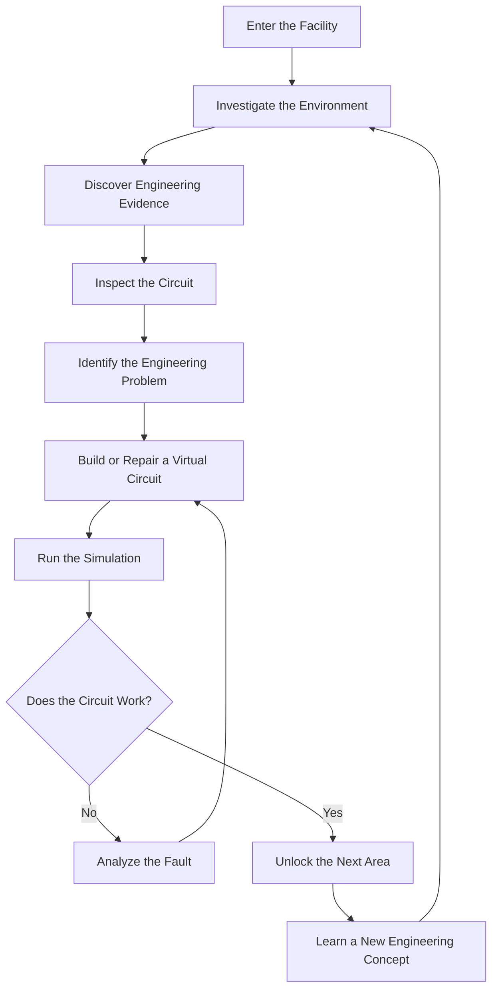

## 2.3 Target audience

The project is designed for:

- High-school STEM learners
- First-year electrical engineering students
- Computer engineering students
- Electronics enthusiasts
- University engineering clubs
- Educators looking for interactive circuit exercises
- Players interested in puzzle and horror games

The technical content should be suitable for introductory university-level electrical engineering while remaining approachable to beginners.

## 2.4 Educational outcomes

By completing the introductory experience, players should be able to:

1. Explain the relationship between voltage, current and resistance.
2. Calculate current through a resistive circuit.
3. Calculate equivalent resistance.
4. Distinguish series and parallel configurations.
5. Apply Kirchhoff's current and voltage laws.
6. Calculate electrical power.
7. Understand basic capacitor charging and discharging.
8. Interpret simple AC signals.
9. Explain the function of diodes and transistors.
10. Use measurement results to diagnose basic circuit faults.

---

# 3. GAME PREMISE AND NARRATIVE

## 3.1 The setting

The game takes place inside an underground experimental engineering facility.

The facility was originally developed to investigate automated electrical infrastructure, industrial control systems, electromagnetic devices, and experimental sensor networks.

The facility is now abandoned.

Its internal systems continue to operate, but their behaviour is increasingly inconsistent.

The player awakens inside a sealed testing chamber with limited information about how they arrived.

A terminal displays a message:

> SYSTEM INITIALIZATION FAILED.
>
> MANUAL ENGINEERING OVERRIDE REQUIRED.
>
> RESTORE THE CIRCUIT TO CONTINUE.

The player must navigate the facility by solving electrical engineering challenges.

## 3.2 Environmental storytelling

The story is communicated through objects and evidence rather than lengthy exposition.

Examples include:

- Damaged circuit diagrams
- Maintenance reports
- Engineering notebooks
- Equipment identification labels
- Laboratory recordings
- Technician incident reports
- Diagnostic terminals
- Security system logs
- Experimental data
- Power distribution diagrams

Each item contributes to both the story and the technical learning experience.

## 3.3 Narrative progression

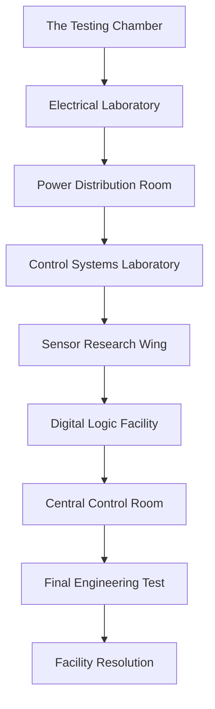

Each location introduces a new engineering subject.

| Location | Engineering subject | Gameplay |
|---|---|---|
| Testing Chamber | Circuit fundamentals | Complete a simple DC loop |
| Electrical Laboratory | Ohm's law | Calculate and repair a circuit |
| Power Distribution Room | Series and parallel | Restore power branches |
| Control Systems Laboratory | Relays | Diagnose a control circuit |
| Sensor Research Wing | Sensors and measurement | Interpret sensor output |
| Digital Logic Facility | Logic gates | Reconstruct a control sequence |
| Central Control Room | Integrated systems | Diagnose multiple interacting faults |
| Final Test | Engineering integration | Solve a multi-stage challenge |

## 3.4 Original intellectual property

The game uses an original setting, original characters, original dialogue, original puzzles, and original visual assets.

Its horror atmosphere draws on general psychological-horror conventions such as isolation, industrial environments, tension, environmental storytelling, and puzzle-driven progression.

It is not an adaptation of an existing horror franchise.

---

# 4. CORE GAMEPLAY LOOP

## 4.1 The main loop

Every mission follows a consistent engineering workflow.

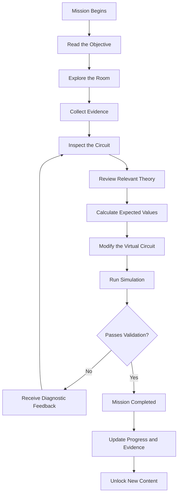

## 4.2 Mission structure

Each mission should contain:

- Mission identifier
- Mission title
- Narrative description
- Educational objective
- Difficulty level
- Required components
- Starting circuit
- Expected electrical behaviour
- Fault conditions
- Available hints
- Success conditions
- Completion rewards
- Associated evidence
- Replay configuration

## 4.3 Example mission

**Mission 01: The First Connection**

<details>
<summary>Mission briefing</summary>

The player enters an isolated testing chamber.

A small indicator lamp is connected to a DC source through a resistor. The control panel reports that the circuit is incomplete.

The player must inspect the circuit and identify the missing connection.

</details>

**Learning objectives**

- Recognize a closed circuit.
- Identify a voltage source.
- Understand the role of a load.
- Explain why current requires a complete path in a conventional lumped circuit model.

**Success condition**

The player must create a valid closed circuit in the virtual simulator.

**Assessment**

The game verifies that:

- A source is present.
- The load is connected.
- The path is electrically continuous.
- The calculated current is within the accepted range.
- The component configuration satisfies the mission constraints.

---

# 5. EDUCATIONAL PHILOSOPHY

## 5.1 Learn, experiment, explain

The game uses a three-stage educational model.

### Stage 1: Learn

The player receives a short explanation of the engineering concept.

Example:

Voltage is the electrical potential difference between two points. It describes the energy transferred per unit charge.

### Stage 2: Experiment

The player changes a virtual circuit.

They can modify:

- Source voltage
- Resistance
- Component placement
- Switch state
- Load configuration
- Measurement location

### Stage 3: Explain

The player receives feedback about why the result occurred.

For example:

Increasing resistance while keeping voltage constant reduces current according to Ohm's law.

This is more meaningful than simply displaying a green success message.

## 5.2 Educational feedback

Incorrect answers should produce useful explanations.

Avoid feedback such as:

> Incorrect. Try again.

Prefer:

> The calculated current is higher than the mission limit. Your circuit contains 100 Ω of resistance, but the required minimum is 200 Ω. Review the relationship between voltage, current and resistance.

## 5.3 Misconception detection

The game should track common misconceptions.

| Misconception | Corrective explanation |
|---|---|
| Voltage and current are interchangeable | Voltage is potential difference; current is charge flow per unit time |
| Resistors consume current | Resistors dissipate electrical energy; current is conserved at circuit nodes |
| Series components have equal voltage | Series components share the same current |
| Parallel components have equal current | Parallel branches share the same voltage |
| A battery supplies unlimited current | Real sources have limitations and internal resistance |
| Capacitors store current | Capacitors store energy in an electric field |
| An LED can always connect directly to a voltage source | Current must be appropriately limited in the simplified circuit model |

## 5.4 Mastery-based progression

A player should demonstrate understanding before advancing to more complex content.

Possible mastery levels:

- Level 0: Not introduced
- Level 1: Recognizes the concept
- Level 2: Explains the concept
- Level 3: Calculates expected values
- Level 4: Builds a correct circuit
- Level 5: Diagnoses unfamiliar faults

The system should track mastery separately for each subject.

---

# 6. ELECTRICAL ENGINEERING CURRICULUM

## 6.1 Module 1: Electricity fundamentals

Topics:

- Electric charge
- Conductors and insulators
- Electric potential
- Voltage
- Current
- Resistance
- Electrical circuits
- Conventional current direction
- Circuit symbols
- Open and closed circuits

Important equations:

\[
I=\frac{Q}{t}
\]

\[
V=\frac{W}{Q}
\]

\[
V=IR
\]

Where:

- \(I\) = current in amperes
- \(Q\) = charge in coulombs
- \(t\) = time in seconds
- \(V\) = voltage in volts
- \(W\) = energy in joules
- \(R\) = resistance in ohms

### Interactive exercise

The player receives a 12 V source and a 600 Ω resistor.

Calculate the current:

\[
I=\frac{12}{600}
\]

\[
I=0.02A=20mA
\]

The simulator should display the calculated current and allow the player to compare it with a virtual ammeter reading.

## 6.2 Module 2: Series circuits

A series circuit contains components connected along one current path.

Equivalent resistance:

\[
R_T=R_1+R_2+\cdots+R_n
\]

For a 12 V source and two resistors:

\[
R_1=100\Omega
\]

\[
R_2=200\Omega
\]

\[
R_T=300\Omega
\]

\[
I=\frac{12}{300}=0.04A
\]

The voltage drops are:

\[
V_1=IR_1=4V
\]

\[
V_2=IR_2=8V
\]

The total voltage drop equals the source voltage.

## 6.3 Module 3: Parallel circuits

Parallel components share the same voltage across their terminals.

Equivalent resistance:

\[
\frac{1}{R_T}=
\frac{1}{R_1}+
\frac{1}{R_2}
\]

For two resistors:

\[
R_T=\frac{R_1R_2}{R_1+R_2}
\]

The game should let players add and remove branches and observe the effect on total resistance and source current.

## 6.4 Module 4: Kirchhoff's laws

**Kirchhoff's Current Law (KCL)**

The algebraic sum of currents at a node is zero.

\[
\sum I=0
\]

**Kirchhoff's Voltage Law (KVL)**

The algebraic sum of voltage changes around a closed loop is zero.

\[
\sum V=0
\]

Interactive missions should require players to identify nodes, choose reference directions, and calculate unknown currents or voltage drops.

## 6.5 Module 5: Electrical power and energy

\[
P=VI
\]

For a resistor:

\[
P=I^2R
\]

\[
P=\frac{V^2}{R}
\]

Energy:

\[
E=Pt
\]

Missions can ask players to compare the power dissipated by different virtual components.

## 6.6 Module 6: Capacitors

Capacitance:

\[
Q=CV
\]

Stored energy:

\[
E=\frac{1}{2}CV^2
\]

For a simple series RC circuit:

\[
\tau=RC
\]

Charging:

\[
V_C(t)=V_s(1-e^{-t/RC})
\]

Discharging:

\[
V_C(t)=V_0e^{-t/RC}
\]

The simulator should display capacitor voltage over time.

## 6.7 Module 7: Inductors

An ideal inductor opposes changes in current.

\[
V_L=L\frac{di}{dt}
\]

Stored magnetic energy:

\[
E=\frac{1}{2}LI^2
\]

For a simple RL circuit:

\[
\tau=\frac{L}{R}
\]

The game should visualize current rising or falling over time.

## 6.8 Module 8: AC fundamentals

Sinusoidal voltage:

\[
v(t)=V_{peak}\sin(\omega t+\phi)
\]

Angular frequency:

\[
\omega=2\pi f
\]

Period:

\[
T=\frac{1}{f}
\]

For a sinusoid:

\[
V_{RMS}=\frac{V_{peak}}{\sqrt{2}}
\]

Players should identify amplitude, frequency, period, and phase.

## 6.9 Module 9: Semiconductors

Topics:

- Diodes
- LEDs
- Rectifiers
- Zener diodes
- Bipolar junction transistors
- MOSFETs
- Operational amplifiers

Interactive activities should show simplified component models, current direction, switching states, and characteristic curves where appropriate.

## 6.10 Module 10: Digital electronics

Topics:

- Binary numbers
- Logic levels
- AND gates
- OR gates
- NOT gates
- NAND and NOR
- XOR and XNOR
- Boolean algebra
- Truth tables
- Combinational logic
- Sequential logic
- Flip-flops
- Registers
- Adders

Example AND gate:

| A | B | Output |
|---:|---:|---:|
| 0 | 0 | 0 |
| 0 | 1 | 0 |
| 1 | 0 | 0 |
| 1 | 1 | 1 |

The player can construct a virtual logic circuit to activate a facility control system.

---

# 7. INTERACTIVE CIRCUIT LABORATORY

## 7.1 Overview

The Circuit Laboratory is the central educational feature.

Players should be able to construct, modify, and test virtual electrical circuits.

It should function as a simplified educational workbench rather than a static image.

## 7.2 Component library

The initial component library should include:

| Category | Components |
|---|---|
| Sources | DC voltage source, ground reference |
| Passive | Resistor, capacitor, inductor |
| Switching | SPST switch, SPDT switch |
| Loads | Lamp, LED, buzzer |
| Semiconductor | Diode, Zener diode, transistor, MOSFET |
| Measurement | Voltmeter, ammeter, virtual probe |
| Control | Relay, sensor, logic gate |
| Connection | Wire, junction, terminal |

## 7.3 Circuit-building workflow

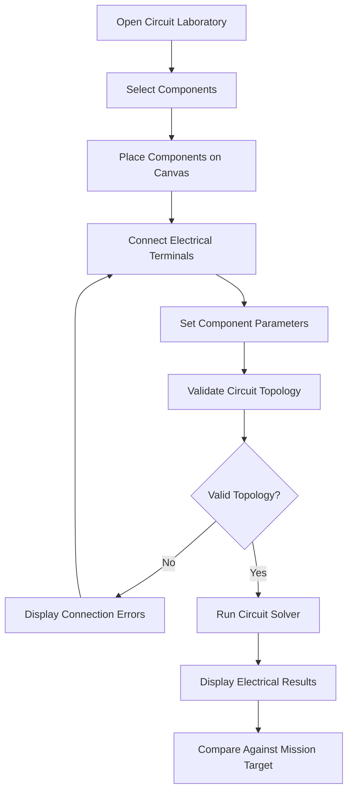

## 7.4 Component configuration

Every component should have:

- Unique identifier
- Component type
- Label
- Position
- Rotation
- Electrical terminals
- Parameter values
- Visual representation
- Simulation model
- Validation rules

Example resistor:

```json
{
  "id": "resistor-001",
  "type": "resistor",
  "label": "R1",
  "resistanceOhms": 220,
  "position": {
    "x": 300,
    "y": 180
  },
  "rotation": 0,
  "terminals": [
    "terminal-a",
    "terminal-b"
  ]
}
```

## 7.5 Laboratory tools

The workbench should include:

- Component selection panel
- Circuit canvas
- Wire connection tool
- Component property editor
- Simulation controls
- Measurement panel
- Formula reference
- Mission instructions
- Hint system
- Reset button
- Circuit save/load

## 7.6 Circuit validation

Validation should occur at multiple levels.

**Level 1: Structural validation**

- Are all required components present?
- Are terminals connected?
- Are there dangling wires?
- Is the source present?
- Is there an unintended short circuit?

**Level 2: Electrical validation**

- Are component values valid?
- Does the circuit have a solvable configuration?
- Are node equations consistent?
- Are calculated values within valid ranges?

**Level 3: Mission validation**

- Does the circuit meet the mission's electrical requirements?
- Is the correct component configuration used?
- Does the measured output meet the target?
- Have all required learning objectives been demonstrated?

---

# 8. CIRCUIT SIMULATION ENGINE

## 8.1 Purpose

The simulation engine converts the player's circuit into mathematical equations and calculates the expected electrical behaviour.

The first implementation should focus on linear DC resistive networks.

Advanced features such as nonlinear semiconductor models, AC analysis, and transient simulation should be added as separate capabilities.

## 8.2 Simulation pipeline

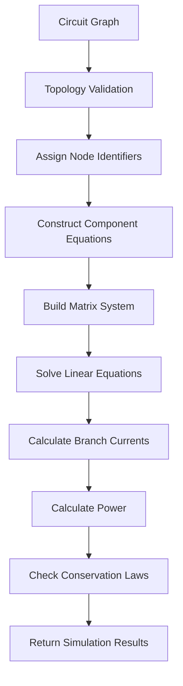

## 8.3 Mathematical foundation

For a linear resistive network, nodal analysis can be expressed as:

\[
G\mathbf{v}=\mathbf{i}
\]

Where:

- \(G\) is the conductance matrix.
- \(\mathbf{v}\) is the vector of unknown node voltages.
- \(\mathbf{i}\) is the vector of injected currents.

For a resistor:

\[
G=\frac{1}{R}
\]

For a resistor between nodes \(a\) and \(b\), its conductance contributes to the diagonal entries associated with both nodes and negative off-diagonal entries.

The reference ground node is assigned zero volts.

## 8.4 Simulation result structure

```typescript
export interface SimulationResult {
  status: "success" | "warning" | "error";

  nodeVoltages: Record<string, number>;

  branchCurrents: Record<string, number>;

  componentPowers: Record<string, number>;

  totalPower: number;

  sourcePower: number;

  residual: number;

  warnings: string[];

  errors: string[];
}
```

## 8.5 Numerical validation

The engine should check:

- Matrix solvability
- Floating nodes
- Singular matrices
- Invalid component values
- Infinite or undefined results
- Excessive numerical residual
- Current conservation
- Voltage conservation
- Power consistency

A solver must not silently return success when the underlying circuit is mathematically invalid.

## 8.6 Simulation accuracy levels

| Level | Model | Purpose |
|---|---|---|
| 1 | Ideal DC components | Beginner circuit puzzles |
| 2 | Resistive network solver | Multi-node circuit analysis |
| 3 | RC/RL transient models | Time-dependent behaviour |
| 4 | AC phasor models | Frequency-domain learning |
| 5 | Nonlinear device models | Advanced electronics |

Each simulation mode should state its assumptions.

## 8.7 Example DC solver pseudocode

```typescript
function solveDcCircuit(
  circuit: CircuitGraph
): SimulationResult {

  const validation = validateCircuit(circuit);

  if (!validation.valid) {
    return {
      status: "error",
      nodeVoltages: {},
      branchCurrents: {},
      componentPowers: {},
      totalPower: 0,
      sourcePower: 0,
      residual: 0,
      warnings: [],
      errors: validation.errors
    };
  }

  const nodes = identifyUnknownNodes(circuit);

  const matrix = buildConductanceMatrix(
    circuit,
    nodes
  );

  const vector = buildCurrentVector(
    circuit,
    nodes
  );

  const solution = solveLinearSystem(
    matrix,
    vector
  );

  if (!solution.converged) {
    return createSolverError(
      "Unable to solve the circuit."
    );
  }

  const voltages = mapNodeVoltages(
    nodes,
    solution.values
  );

  const currents = calculateBranchCurrents(
    circuit,
    voltages
  );

  const powers = calculateComponentPowers(
    circuit,
    voltages,
    currents
  );

  return validateSimulationResults({
    voltages,
    currents,
    powers
  });
}
```

This pseudocode describes the intended architecture. It is not a claim that every solver capability is already implemented.

---

# 9. TECHNICAL CIRCUIT DIAGRAMS

The following diagrams use Mermaid and simplified circuit notation. They are intended as technical documentation and educational references.

## 9.1 Basic DC circuit

A basic DC circuit contains a source, a load, and a closed connection path.

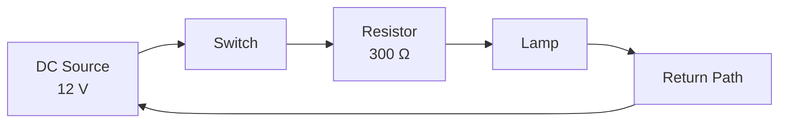

The current is determined by the total resistance of the circuit.

For a simplified 12 V source and 300 Ω load:

\[
I=\frac{12}{300}=0.04A
\]

## 9.2 Series circuit

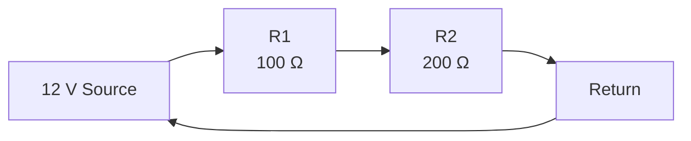

Equivalent resistance:

\[
R_T=100+200=300\Omega
\]

Circuit current:

\[
I=\frac{12}{300}=40mA
\]

Voltage drops:

\[
V_1=4V
\]

\[
V_2=8V
\]

## 9.3 Parallel circuit

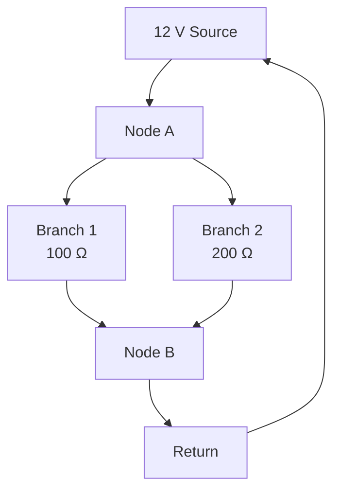

Equivalent resistance:

\[
R_T=\frac{100(200)}{100+200}
\]

\[
R_T=66.67\Omega
\]

Each branch has 12 V across it.

Branch currents:

\[
I_1=120mA
\]

\[
I_2=60mA
\]

Total current:

\[
I_T=180mA
\]

## 9.4 RC charging circuit

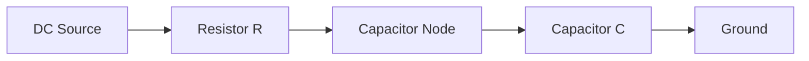

The capacitor voltage rises exponentially during charging.

\[
V_C(t)=V_s(1-e^{-t/RC})
\]

The time constant is:

\[
\tau=RC
\]

After approximately five time constants, an ideal first-order charging response is very close to its final value.

## 9.5 Relay control system

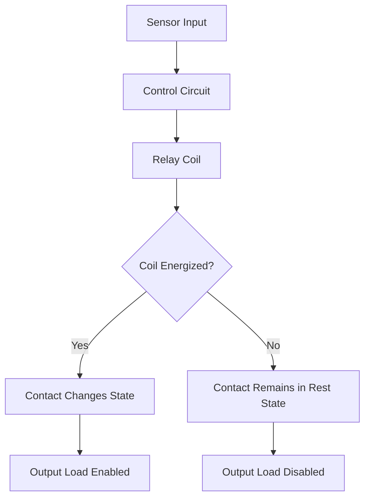

The game should distinguish between the relay coil circuit and the switched contact circuit.

## 9.6 Digital logic system

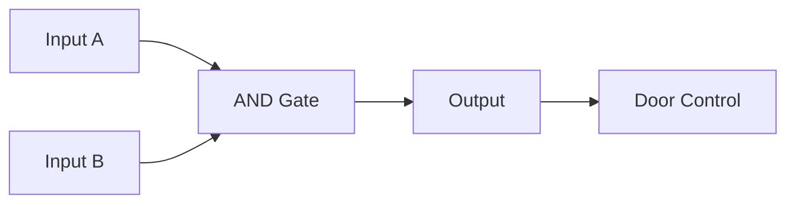

The door control output becomes active only when both inputs satisfy the gate's logic condition.

## 9.7 Complete game architecture

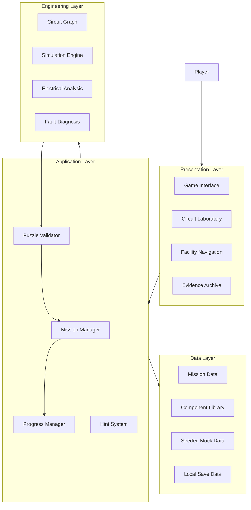

---

# 10. GAME ARCHITECTURE

## 10.1 Main game systems

The application should be divided into independent systems.

### Game state manager

Controls:

- Current mission
- Current room
- Player progress
- Active puzzle
- Mission completion
- Current difficulty
- Game settings

### Mission manager

Controls:

- Mission loading
- Mission objectives
- Starting configurations
- Success criteria
- Failure states
- Mission transitions

### Circuit laboratory

Controls:

- Component placement
- Wire connections
- Component configuration
- Circuit graph
- Simulation requests

### Evidence manager

Controls:

- Evidence collection
- Evidence categorization
- Investigation progress
- Narrative unlocks
- Evidence search

### Save manager

Controls:

- Progress persistence
- Settings persistence
- Completed missions
- Unlocked evidence
- Circuit configurations

## 10.2 Event-driven gameplay

Game systems should communicate through typed events rather than tightly coupling every component.

Example events:

```typescript
export type GameEvent =
  | {
      type: "MISSION_STARTED";
      missionId: string;
    }
  | {
      type: "EVIDENCE_COLLECTED";
      evidenceId: string;
    }
  | {
      type: "CIRCUIT_SIMULATED";
      missionId: string;
      success: boolean;
    }
  | {
      type: "MISSION_COMPLETED";
      missionId: string;
    }
  | {
      type: "HINT_USED";
      missionId: string;
    };
```

This makes it easier to add achievements, analytics, sound triggers, and future multiplayer features without rewriting the core game.

---

# 11. SOFTWARE ARCHITECTURE

## 11.1 Technology foundation

The existing project foundation uses a modern web application approach.

| Technology | Responsibility |
|---|---|
| React | Component-based user interface |
| TypeScript | Type safety |
| CSS | Visual styling and animations |
| Browser LocalStorage | Local progress persistence |
| Mermaid | Technical diagrams in documentation |
| Testing framework | Automated verification |

The exact package versions and available dependencies should be taken from the repository's package configuration.

## 11.2 Suggested project structure

```text
the-electric-bathtub/
│
├── public/
│   ├── assets/
│   ├── audio/
│   ├── images/
│   └── icons/
│
├── src/
│   ├── app/
│   │   ├── App.tsx
│   │   ├── routes/
│   │   └── providers/
│   │
│   ├── components/
│   │   ├── ui/
│   │   ├── layout/
│   │   ├── navigation/
│   │   └── feedback/
│   │
│   ├── game/
│   │   ├── engine/
│   │   ├── state/
│   │   ├── missions/
│   │   ├── rooms/
│   │   ├── progression/
│   │   └── events/
│   │
│   ├── circuits/
│   │   ├── components/
│   │   ├── graph/
│   │   ├── solver/
│   │   ├── analysis/
│   │   ├── validation/
│   │   └── diagrams/
│   │
│   ├── education/
│   │   ├── lessons/
│   │   ├── formulas/
│   │   ├── examples/
│   │   ├── quizzes/
│   │   └── mastery/
│   │
│   ├── evidence/
│   │   ├── archive/
│   │   ├── records/
│   │   └── investigation/
│   │
│   ├── data/
│   │   ├── missions/
│   │   ├── components/
│   │   ├── evidence/
│   │   ├── profiles/
│   │   └── generators/
│   │
│   ├── services/
│   │   ├── storage/
│   │   ├── export/
│   │   └── analytics/
│   │
│   ├── styles/
│   └── types/
│
├── tests/
│   ├── unit/
│   ├── integration/
│   ├── circuits/
│   └── gameplay/
│
├── docs/
│   ├── ARCHITECTURE.md
│   ├── CIRCUIT_ENGINE.md
│   ├── CURRICULUM.md
│   ├── GAME_DESIGN.md
│   └── CONTRIBUTING.md
│
├── package.json
└── README.md
```

This is a recommended modular organization. Existing files should be preserved and migrated incrementally rather than replaced wholesale.

## 11.3 TypeScript domain types

```typescript
export type Difficulty =
  | "beginner"
  | "intermediate"
  | "advanced";

export type MissionStatus =
  | "locked"
  | "available"
  | "in_progress"
  | "completed";

export interface Mission {
  id: string;
  title: string;
  description: string;

  subject: string;
  difficulty: Difficulty;

  objectives: string[];

  requiredComponents: string[];

  estimatedMinutes: number;

  status: MissionStatus;

  rewards: {
    experience: number;
    evidenceIds: string[];
  };
}
```

## 11.4 Separation of concerns

The user interface should never be responsible for performing electrical calculations.

Instead:

1. The UI captures player changes.
2. The circuit editor updates the circuit graph.
3. The validation service checks topology.
4. The solver calculates electrical values.
5. The mission validator compares results with expected conditions.
6. The UI displays results.

This separation makes the application easier to test and maintain.

---

# 12. DATA MODELS AND MOCK DATA

## 12.1 Purpose of mock data

Mock data allows the game to be developed and demonstrated without depending on a live backend.

It supports:

- Mission demonstrations
- Replayable puzzles
- Simulated facility records
- Player profiles
- Evidence archives
- Testing
- Educational examples
- Scenario generation

Mock data should be deterministic when a seed is provided.

## 12.2 Mission data example

```typescript
const mission = {
  id: "mission-001",

  title: "The First Connection",

  subject: "circuit-fundamentals",

  difficulty: "beginner",

  description:
    "Restore the incomplete virtual circuit.",

  objectives: [
    "Identify the source",
    "Identify the load",
    "Complete the circuit",
    "Calculate expected current"
  ],

  circuit: {
    sourceVoltage: 12,
    resistanceOhms: 600
  },

  expected: {
    currentAmps: 0.02
  },

  tolerance: 0.0001
};
```

## 12.3 Component data

A component catalogue should contain:

- Component ID
- Component name
- Category
- Symbol
- Terminal count
- Electrical parameters
- Default values
- Valid parameter ranges
- Educational description
- Simulation model identifier

## 12.4 Evidence data

```typescript
export interface EvidenceRecord {
  id: string;

  title: string;

  category:
    | "maintenance"
    | "engineering"
    | "incident"
    | "research"
    | "security";

  roomId: string;

  description: string;

  discovered: boolean;

  relatedMissionIds: string[];

  narrativeImportance: number;

  timestampLabel: string;
}
```

## 12.5 Fictional data generation

The seeded scenario generator should create reproducible data.

Example:

```typescript
interface ScenarioConfig {
  seed: number;
  difficulty: Difficulty;
  subject: string;
  componentCount: number;
  faultCount: number;
}
```

A seeded random number generator ensures that the same configuration produces the same scenario.

This is important for:

- Repeatable tests
- Bug reproduction
- Educational assessment
- Consistent demonstrations
- Comparing player performance

## 12.6 Example data expansion

The current expanded prototype includes a mock-data direction with:

- 12 example missions
- 48 example components
- 30 evidence records
- 70 activity events
- 15 fictional trainee profiles

These are demo and development datasets, not real users or operational facility records.

---

# 13. MISSION AND PUZZLE GENERATION

## 13.1 Why procedural missions?

Fixed missions provide structured learning, but randomized missions improve replayability.

The game should combine:

1. Carefully designed core missions.
2. Parameterized circuit variations.
3. Randomized fault scenarios.
4. Optional challenge missions.

The educational objective must remain consistent even when component values change.

## 13.2 Example: randomized Ohm's law mission

The generator selects:

- Source voltage
- Resistor value
- Target current
- Difficulty
- Number of distractor components

Example:

```typescript
function generateOhmsLawScenario(seed: number) {
  const random = createSeededRandom(seed);

  const voltageOptions = [5, 9, 12, 15, 18];

  const resistanceOptions = [
    100,
    220,
    330,
    470,
    680,
    1000
  ];

  const voltage = choose(
    random,
    voltageOptions
  );

  const resistance = choose(
    random,
    resistanceOptions
  );

  return {
    seed,
    voltage,
    resistance,
    expectedCurrent:
      voltage / resistance
  };
}
```

## 13.3 Fault generation

The fault generator should introduce controlled errors.

Examples:

- Open circuit
- Missing component
- Incorrect resistor value
- Incorrect connection
- Shorted branch
- Reversed diode
- Incorrect relay logic
- Incorrect sensor threshold
- Missing ground reference

Each fault should include:

- Fault type
- Affected component
- Symptoms
- Expected diagnostic result
- Educational explanation
- Valid repair

## 13.4 Fault diagnosis workflow

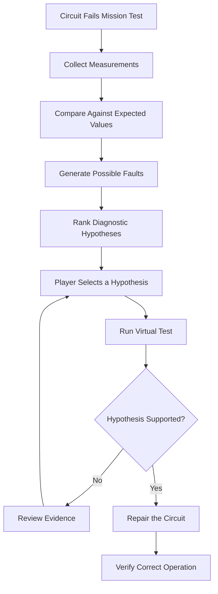

The game should reward correct diagnostic reasoning, not just the number of attempts.

---

# 14. EVIDENCE AND INVESTIGATION SYSTEM

## 14.1 Purpose

The evidence system connects the engineering curriculum to the narrative.

Every mission can reveal information about the facility.

The player builds an archive of:

- Engineering notes
- Maintenance reports
- Circuit diagrams
- Test results
- Incident logs
- Research documents
- Security records

## 14.2 Evidence categories

| Category | Example |
|---|---|
| Engineering | Circuit design specification |
| Maintenance | Component replacement report |
| Incident | Unexpected system shutdown |
| Research | Experimental capacitor data |
| Security | Door access control record |
| Personnel | Fictional technician notebook |

## 14.3 Evidence connections

The evidence archive should allow the player to connect related records.

For example:

- A maintenance record identifies a relay.
- A circuit diagram shows the relay's control connection.
- A diagnostic report identifies an incorrect switching condition.
- A laboratory log reveals when the fault first occurred.

This turns technical documentation into an investigative puzzle.

## 14.4 Evidence graph

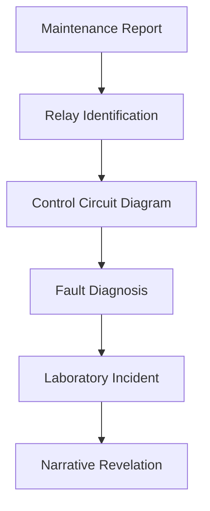

## 14.5 Evidence interface

The archive should include:

- Search
- Category filters
- Discovery status
- Related mission links
- Evidence details
- Timeline
- Connection view
- Export functionality

The player should be able to review previously discovered evidence without repeating completed missions.

---

# 15. USER INTERFACE AND VISUAL DESIGN

## 15.1 Art direction

The visual identity should communicate an abandoned industrial research facility.

The interface should feel:

- Dark
- Technical
- Claustrophobic
- Atmospheric
- Industrial
- Suspenseful
- Readable
- Professionally designed

The horror atmosphere should never make engineering diagrams difficult to read.

## 15.2 Suggested colour palette

| Purpose | Colour |
|---|---|
| Main background | `#090A0D` |
| Secondary background | `#15171C` |
| Panel background | `#20242A` |
| Primary text | `#F2F2F2` |
| Secondary text | `#A5ABB4` |
| Alert red | `#C62828` |
| Electrical cyan | `#00CFE8` |
| Warning amber | `#E7A23B` |
| Success green | `#43B581` |

## 15.3 Interface layout

The laboratory should use a three-panel interface.

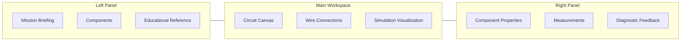

## 15.4 Visual hierarchy

The player must always understand:

1. What they are trying to accomplish.
2. Which circuit they are interacting with.
3. What the important electrical values are.
4. Whether the simulation is running.
5. Why the circuit passed or failed.

## 15.5 Animation

Recommended animations:

- Flickering fluorescent lights
- Subtle CRT scan lines
- Terminal cursor movement
- Power restoration effects
- Circuit signal indicators
- Relay switching animation
- Oscilloscope waveforms
- Door unlocking sequences
- Evidence discovery transitions

Animations should respect reduced-motion preferences.

## 15.6 Sound design

Potential sound categories:

- Low industrial ambience
- Electrical hum
- Relay clicks
- Switch sounds
- Equipment startup
- Terminal notifications
- Door mechanisms
- Distant mechanical sounds
- Mission completion cues

The game should include separate volume controls for ambience, effects, and interface sounds.

---

# 16. PROGRESSION, SCORING AND DIFFICULTY

## 16.1 Player progression

Progression should reflect engineering mastery rather than only time spent playing.

The game can award experience for:

- Correct calculations
- Successful circuit construction
- Accurate measurements
- Correct fault diagnosis
- Completing optional challenges
- Collecting evidence
- Explaining engineering concepts

## 16.2 Scoring model

An illustrative scoring formula:

\[
S=B+M+E-H-P
\]

Where:

- \(S\) = final score
- \(B\) = base mission score
- \(M\) = measurement accuracy bonus
- \(E\) = evidence bonus
- \(H\) = hint penalty
- \(P\) = unnecessary-attempt penalty

The system should prioritize learning. Hint usage should not prevent a player from completing the game.

## 16.3 Difficulty modes

| Mode | Description |
|---|---|
| Beginner | Guided steps and detailed explanations |
| Intermediate | Fewer hints and more independent calculations |
| Advanced | Complex circuits and limited diagnostic assistance |

Difficulty should adjust:

- Number of components
- Number of faults
- Complexity of topology
- Amount of provided information
- Numerical precision
- Time pressure, if enabled
- Hint availability

## 16.4 Learning analytics

The player profile can track:

- Lessons completed
- Missions completed
- Average calculation accuracy
- Fault diagnosis success
- Hint usage
- Subject mastery
- Time spent learning
- Common misconceptions

Analytics should be local by default unless an explicitly configured backend is introduced.

---

# 17. TESTING AND QUALITY ASSURANCE

## 17.1 Testing philosophy

The circuit simulator must be tested as an engineering calculation system, not only as a visual interface.

The application should use:

- Unit tests
- Integration tests
- Circuit solver tests
- Mission validation tests
- UI interaction tests
- Accessibility checks
- Regression tests

## 17.2 Electrical calculation test cases

### Test 1: Ohm's law

Given:

\[
V=12V,\quad R=600\Omega
\]

Expected:

\[
I=0.02A
\]

### Test 2: Series resistors

Given:

\[
R_1=100\Omega
\]

\[
R_2=200\Omega
\]

Expected:

\[
R_T=300\Omega
\]

### Test 3: Parallel resistors

Given:

\[
R_1=100\Omega
\]

\[
R_2=200\Omega
\]

Expected:

\[
R_T\approx66.67\Omega
\]

### Test 4: Power

Given:

\[
V=12V,\quad R=600\Omega
\]

Expected:

\[
P=\frac{V^2}{R}=0.24W
\]

### Test 5: Kirchhoff's current law

For a node with two incoming branches:

\[
I_1=3A,\quad I_2=2A
\]

Expected outgoing current:

\[
I_3=5A
\]

## 17.3 Automated testing example

```typescript
describe("Ohm's Law", () => {
  it("calculates current correctly", () => {
    const current = calculateCurrent(
      12,
      600
    );

    expect(current).toBeCloseTo(0.02);
  });
});
```

## 17.4 Circuit validation tests

Test cases should include:

- Complete circuit
- Open circuit
- Missing ground reference
- Floating node
- Invalid resistance
- Duplicate component IDs
- Disconnected branch
- Incorrect terminal count
- Short circuit
- Singular circuit matrix

## 17.5 Gameplay tests

The game should verify:

- New game initialization
- Mission unlocking
- Mission completion
- Evidence discovery
- Progress persistence
- Save restoration
- Difficulty switching
- Hint functionality
- Circuit reset
- Scenario reproducibility

## 17.6 Performance targets

Suggested development targets, to be measured rather than assumed:

| Area | Target |
|---|---|
| Initial interface | Fast first render |
| Circuit editing | Responsive interaction |
| Small DC simulations | Near-instant feedback |
| Evidence search | Responsive filtering |
| Save operations | No noticeable blocking |
| Mobile layout | Functional at narrow widths |
| Accessibility | Keyboard-operable controls |

---

# 18. INSTALLATION AND DEVELOPMENT

## 18.1 Requirements

Install:

- Node.js
- npm
- Git
- A modern web browser

Use the version requirements declared in the repository.

## 18.2 Clone the repository

```bash
git clone https://github.com/lucylow/the-electric-bathtub.git

cd the-electric-bathtub
```

## 18.3 Install dependencies

```bash
npm install
```

## 18.4 Start the development server

```bash
npm run dev
```

Open the local URL printed by the development server.

## 18.5 Build the application

```bash
npm run build
```

## 18.6 Run tests

```bash
npm test
```

The exact available scripts depend on the current `package.json`. If a command is not configured, add the corresponding development dependency and script before relying on it.

## 18.7 Development workflow

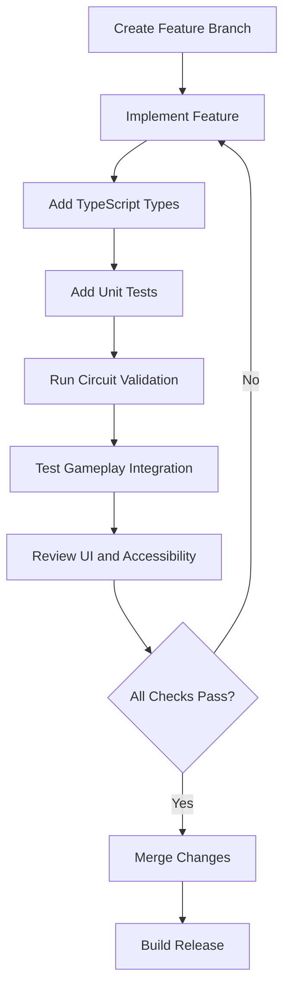

## 18.8 Contributing

Contributors should:

1. Keep circuit calculations separate from UI code.
2. Add tests for new mathematical functions.
3. Document component models and assumptions.
4. Use typed data structures.
5. Preserve deterministic scenario generation.
6. Avoid introducing unverified engineering equations.
7. Include accessibility considerations.
8. Avoid breaking existing missions.
9. Keep narrative and educational content independently maintainable.
10. Document any new dependencies.

---

# 19. SAFETY, ACCESSIBILITY AND EDUCATIONAL INTEGRITY

## 19.1 Virtual-only electrical experimentation

The Electric Bathtub is an educational software simulation.

All electrical puzzles and experiments are virtual.

The game should not encourage players to recreate fictional electrical hazards, connect real mains electricity, or experiment with dangerous high-voltage equipment.

All demonstrations should use clearly identified virtual sources and simplified models.

## 19.2 Engineering assumptions

Every simulation should identify its assumptions.

Examples:

- Ideal voltage source
- Ideal resistor
- Lumped circuit model
- Fixed component temperature
- No parasitic capacitance
- No parasitic inductance
- Simplified semiconductor behaviour

Advanced models can be introduced later.

## 19.3 Accessibility

The interface should support:

- Keyboard navigation
- Visible focus indicators
- Screen-reader labels
- High-contrast text
- Adjustable text size
- Reduced motion
- Captions for audio information
- Non-colour-only status indicators
- Clear error messages

## 19.4 Educational integrity

The game should distinguish between:

- A simplified educational model
- A numerical approximation
- An idealized circuit
- A real-world component
- A real-world engineering design

For example, a simplified LED model can teach forward voltage and current limiting, but should not be presented as a complete physical semiconductor model.

The simulator is an educational tool, not a replacement for professional electrical engineering design software or supervised physical laboratory instruction.

---

# 20. ROADMAP AND FUTURE DEVELOPMENT

## 20.1 Development philosophy

The project should evolve in stages.

The priority is to establish a mathematically correct, playable educational experience before expanding into advanced graphics, complex narrative systems, or multiplayer features.

## 20.2 Phase 1 — Core game foundation

- [x] React and TypeScript project foundation
- [x] Horror-themed game direction
- [x] Mission-based progression concept
- [x] Basic electrical learning content
- [x] Virtual circuit puzzle concepts
- [x] Evidence archive concept
- [x] Local progress persistence
- [x] Expanded mock-data direction
- [ ] Fully integrated circuit-building laboratory
- [ ] Comprehensive DC circuit solver
- [ ] Complete automated electrical test suite

## 20.3 Phase 2 — Interactive electrical laboratory

- [ ] Drag-and-drop circuit components
- [ ] Terminal-to-terminal wiring
- [ ] Component property editor
- [ ] Real-time circuit validation
- [ ] DC nodal analysis
- [ ] Voltage and current probes
- [ ] Circuit result visualization
- [ ] Circuit save and load
- [ ] Formula reference panel

## 20.4 Phase 3 — Engineering curriculum

- [ ] Interactive Ohm's law lessons
- [ ] Series and parallel laboratories
- [ ] Kirchhoff's law exercises
- [ ] Power and energy challenges
- [ ] Capacitor charging simulation
- [ ] Inductor transient simulation
- [ ] AC waveform laboratory
- [ ] Semiconductor lessons
- [ ] Digital logic challenges
- [ ] Measurement and troubleshooting modules

## 20.5 Phase 4 — Horror and narrative expansion

- [ ] Additional facility environments
- [ ] Original character development
- [ ] Environmental storytelling
- [ ] Audio atmosphere
- [ ] Dynamic lighting
- [ ] Branching narrative
- [ ] Additional evidence chains
- [ ] Multiple endings
- [ ] More complex facility systems

## 20.6 Phase 5 — Advanced simulation

- [ ] RC and RL transient solver
- [ ] RLC circuit simulation
- [ ] AC phasor analysis
- [ ] Frequency response
- [ ] Diode models
- [ ] Transistor switching models
- [ ] MOSFET switching models
- [ ] Operational amplifier models
- [ ] Logic circuit simulation
- [ ] Oscilloscope visualization

## 20.7 Phase 6 — Educational intelligence

- [ ] Adaptive difficulty
- [ ] Personalized learning progression
- [ ] Misconception detection
- [ ] Automated hint recommendations
- [ ] Mastery assessment
- [ ] More worked examples
- [ ] Larger question bank
- [ ] Performance dashboard
- [ ] Teacher and classroom mode

## 20.8 Phase 7 — Product readiness

- [ ] Mobile and tablet optimization
- [ ] Improved performance
- [ ] Complete accessibility audit
- [ ] Save-data reliability
- [ ] Cross-browser testing
- [ ] Automated deployment
- [ ] Full documentation
- [ ] User testing
- [ ] Educational content review
- [ ] Release candidate

---

# APPENDIX A — FORMULA REFERENCE

## Electrical fundamentals

| Concept | Formula |
|---|---|
| Current | \(I=Q/t\) |
| Voltage | \(V=W/Q\) |
| Ohm's law | \(V=IR\) |
| Conductance | \(G=1/R\) |
| Electrical power | \(P=VI\) |
| Resistive power | \(P=I^2R\) |
| Resistive power | \(P=V^2/R\) |
| Energy | \(E=Pt\) |

## Series and parallel

| Concept | Formula |
|---|---|
| Series resistance | \(R_T=\sum R_i\) |
| Parallel resistance | \(1/R_T=\sum 1/R_i\) |
| Voltage divider | \(V_{out}=V_{in}\frac{R_2}{R_1+R_2}\) |
| Two-branch current divider | \(I_1=I_T\frac{R_2}{R_1+R_2}\) |

The voltage divider formula assumes the output is unloaded or that the loading effect has been included in the equivalent resistance.

## Capacitors and inductors

| Concept | Formula |
|---|---|
| Capacitor charge | \(Q=CV\) |
| Capacitor energy | \(E=\frac12CV^2\) |
| RC time constant | \(\tau=RC\) |
| Inductor voltage | \(V_L=L\,di/dt\) |
| Inductor energy | \(E=\frac12LI^2\) |
| RL time constant | \(\tau=L/R\) |

## AC fundamentals

| Concept | Formula |
|---|---|
| Angular frequency | \(\omega=2\pi f\) |
| Period | \(T=1/f\) |
| RMS voltage | \(V_{RMS}=V_{peak}/\sqrt2\) |
| Capacitive reactance | \(X_C=1/(2\pi fC)\) |
| Inductive reactance | \(X_L=2\pi fL\) |
| Impedance | \(Z=R+jX\) |
| Sinusoidal real power | \(P=V_{RMS}I_{RMS}\cos\phi\) |

---

# APPENDIX B — EXAMPLE EDUCATIONAL MISSION CATALOGUE

| Mission | Subject | Difficulty |
|---|---|---|
| The First Connection | Circuit fundamentals | Beginner |
| The Resistance Test | Ohm's law | Beginner |
| The Broken Path | Continuity | Beginner |
| The Two Branches | Parallel circuits | Beginner |
| The Long Corridor | Series circuits | Beginner |
| The Voltage Balance | Kirchhoff's voltage law | Intermediate |
| The Missing Current | Kirchhoff's current law | Intermediate |
| The Overloaded Panel | Electrical power | Intermediate |
| The Stored Charge | Capacitors | Intermediate |
| The Magnetic Lock | Inductors | Intermediate |
| The Signal Room | AC fundamentals | Intermediate |
| The Switching Chamber | Transistors | Advanced |
| The Logic Door | Digital logic | Intermediate |
| The Fault Archive | Troubleshooting | Advanced |
| Central Control | Integrated circuit analysis | Advanced |

---

# APPENDIX C — FUTURE TECHNICAL EXTENSIONS

## C.1 Advanced circuit solver

The long-term solver architecture can support modified nodal analysis (MNA).

MNA extends nodal analysis to accommodate ideal voltage sources and other circuit elements.

A generalized matrix formulation is:

\[
\begin{bmatrix}
G & B\\
C & D
\end{bmatrix}
\begin{bmatrix}
v\\
i
\end{bmatrix}
=
\begin{bmatrix}
j\\
e
\end{bmatrix}
\]

The exact matrix construction depends on the component models and circuit topology.

## C.2 Transient simulation

Future transient analysis should solve circuit differential equations.

Possible numerical methods include:

- Forward Euler
- Backward Euler
- Trapezoidal integration

The solver should include:

- Time-step selection
- Stability considerations
- Initial conditions
- Error monitoring
- Simulation termination conditions

## C.3 Frequency-domain simulation

AC analysis should support:

- Complex impedance
- Phasor representation
- Frequency sweeps
- Magnitude response
- Phase response
- Resonance
- Filter behaviour

For an ideal series RLC circuit:

\[
Z=R+j\left(\omega L-\frac{1}{\omega C}\right)
\]

## C.4 Engineering visualization

Future visualizations could include:

- Animated current indicators
- Node voltage overlays
- Oscilloscope traces
- Frequency response plots
- Capacitor charge curves
- Inductor current curves
- Component power displays
- Logic timing diagrams

These visualizations should be driven by simulation results rather than decorative animations that imply incorrect electrical behaviour.

---

# APPENDIX D — PROJECT SUCCESS CRITERIA

The Electric Bathtub should be considered successful when it delivers three connected experiences.

**1. A compelling horror game**

Players want to explore the facility, discover its secrets, and solve its puzzles.

**2. A credible engineering learning environment**

Players can build circuits, calculate electrical values, investigate faults, and understand the reasoning behind the results.

**3. A technically maintainable application**

The software has modular architecture, tested calculations, deterministic mission data, reliable persistence, and clear documentation.

The most important measure is not how many circuit questions the game contains.

It is whether players leave with a stronger understanding of how electrical systems work.

---

# FINAL PROJECT STATEMENT

**The Electric Bathtub transforms electrical engineering into a survival experience.**

Inside an abandoned research facility, every locked door represents an engineering problem. Every malfunction reveals an opportunity to investigate. Every circuit becomes a puzzle that requires scientific reasoning.

Players learn by experimenting, calculating, testing, and diagnosing.

The goal is to make electrical engineering memorable, interactive, technically credible, and genuinely fun to learn.

**The facility is waiting. The circuits are incomplete. Begin the investigation.**
